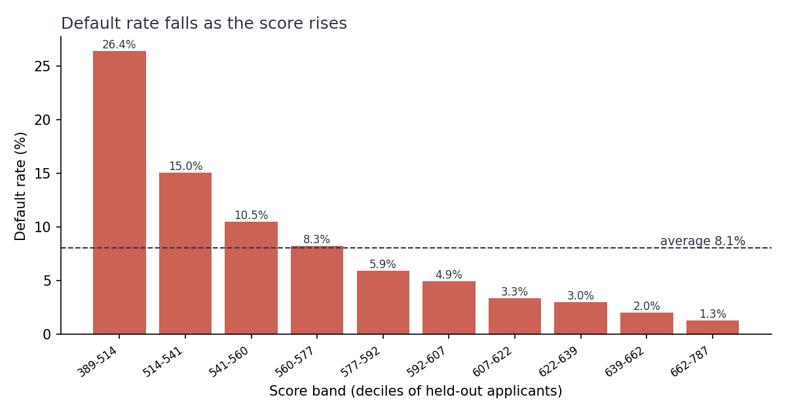
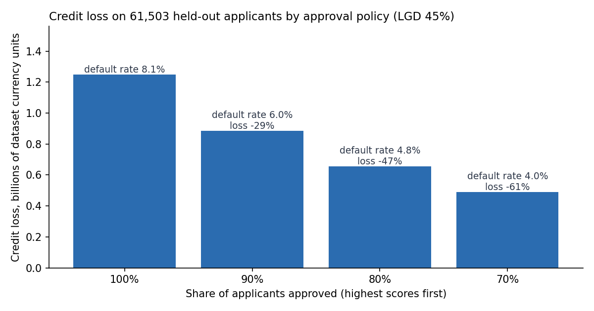
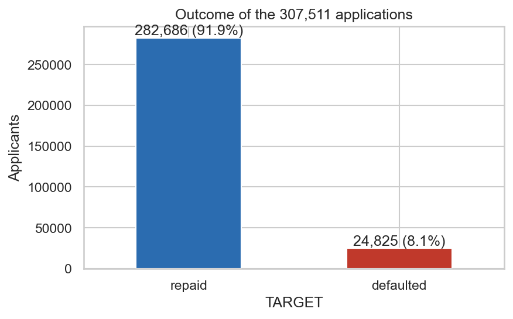
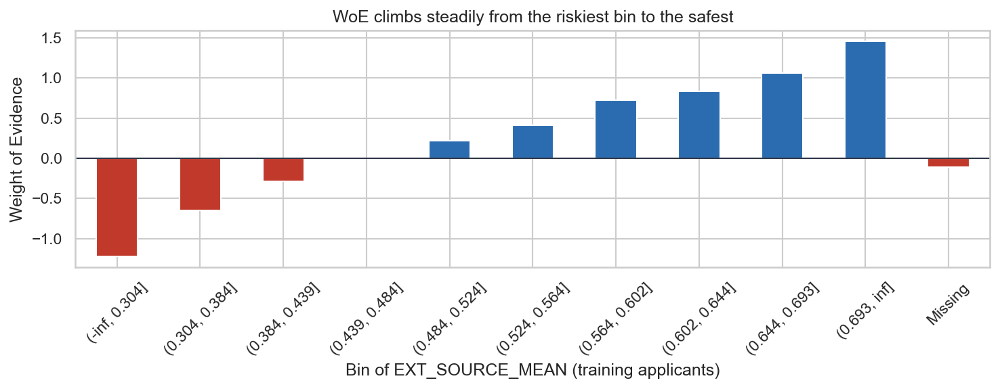
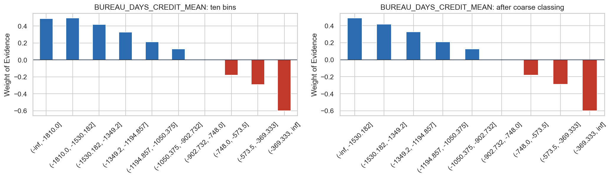
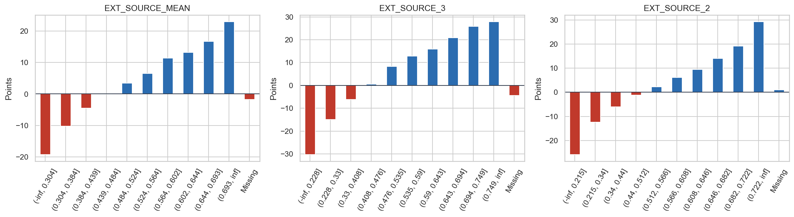
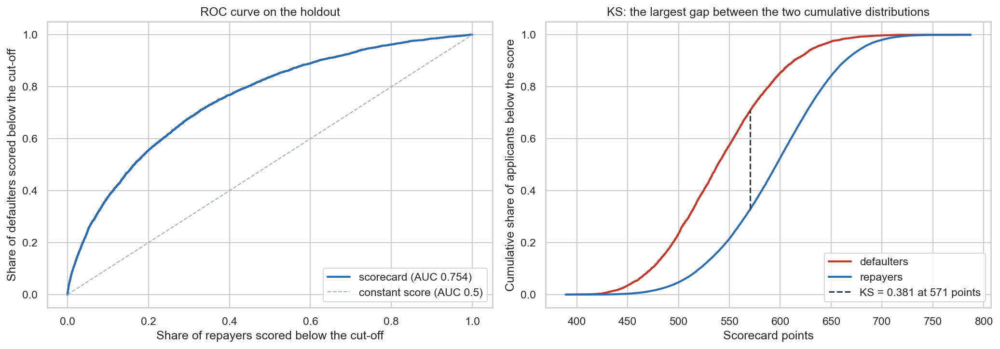
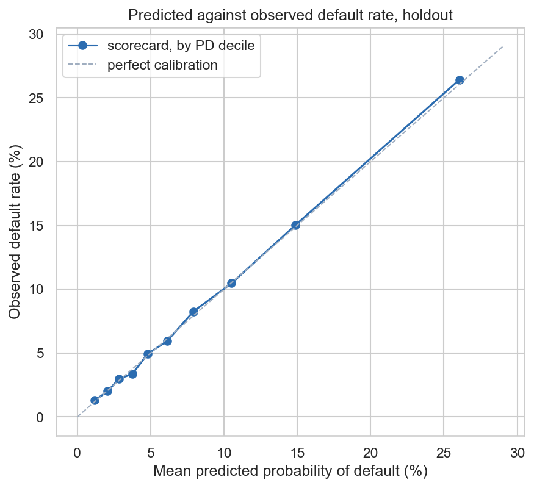

# Credit Risk Scorecard

A points-based score that tells a lender which loan applicants are likely to default, and gives a reason for every decline, built on 307,511 Home Credit applications.

[](LICENSE)
[](#how-to-run)
[](https://github.com/alvenyuka/Credit-Risk-Scorecard/actions/workflows/ci.yml)



## What this project does

A lender approves or declines each loan application. Approving someone who later defaults costs a large part of the amount lent. Declining someone who would have repaid costs the profit on a good loan. In many countries a declined applicant is also owed a reason, which a scorecard gives directly, one line per characteristic.

A scorecard handles this by giving each applicant points for each answer on the application, such as the external credit score band or the education level, and adding them up. A low total means higher risk, and the points show where the applicant lost ground. The question here is how many credit losses such a fully explainable score can remove, and what that readability costs compared with a stronger black-box model.

Data: the Home Credit Default Risk dataset from Kaggle, 307,511 applications with a known outcome (8.1% defaulted) across 8 linked tables (7 are used in the model: the application table and six history tables).

## Results

All figures are measured on a random 20% of applicants (61,503) that was held back and never used to fit the model. Sources: `outputs/results.json`, `outputs/business_impact.json`, `outputs/challengers.json`.

- **The score ranks risk well.** AUC 0.754: pick one applicant who defaulted and one who repaid at random, and the score puts the defaulter lower about 75% of the time (95% bootstrap interval 0.747 to 0.761: the range the AUC falls in 95% of the time when the holdout is resampled repeatedly).
- **Defaults concentrate at the bottom.** The lowest-scoring tenth of applicants defaulted 26.4% of the time, the highest-scoring tenth 1.3%.
- **Approving only the top 80% cuts credit losses by 47%.** That costs turning away 17.2% of the borrowers who would have repaid.
- **The score doubles as a probability.** Predicted and observed default rates agree within 0.4 percentage points in every tenth of applicants.
- **Readability has a price.** LightGBM, a tree-based model whose inner workings are hard to explain, reaches AUC 0.781 on the same applicants, 0.027 above the scorecard's 0.754 (step 11 gives the details).

Try it: the [live case study](https://credit-risk-alven.vercel.app) has an approval-policy explorer and a "Score an applicant" calculator that adds up the points for all 32 characteristics. It reads the same output files as this README (see `demo/README.md`).

| Measure (holdout of 61,503) | Value | What it means |
|---|---:|---|
| AUC | 0.754 | Described above. 0.5 is a coin flip, 1.0 is perfect. |
| KS | 0.381 | The widest gap between the share of defaulters and the share of repayers scoring below the same cut-off. |
| Gini | 0.508 | AUC rescaled to run from 0 to 1 (2 x AUC - 1). |
| Mean score, repaid vs defaulted | 594 vs 542 | Scores run from 389 to 787 on the holdout. |
| Good-to-bad odds near 600 points | 20.2 observed, 20.0 designed | Applicants scoring 580 to 620 repaid about 20 for every 1 who defaulted, as the scale intends. |
| Score stability, training vs holdout (PSI) | 0.0002 | Population Stability Index: how far the score distribution moved between two groups. Under 0.1 is usually read as stable. Here both groups are random slices of the same file, so a value near 0 is expected and says nothing about drift over time. |

Money table, produced by `src/business_impact.py` into `outputs/business_impact.json`. Credit loss is the credit amount of each approved loan that defaulted, times a loss given default (the share of the amount lost when a borrower defaults) of 45%, the value set by the Basel bank-capital rules (foundation internal-ratings-based approach) for senior unsecured lending. Home Credit does not state its currency, so amounts are in its own units.

| Policy | Approved | Default rate among approved | Credit loss | Loss avoided | Good borrowers declined |
|---|---:|---:|---:|---:|---:|
| Approve everyone | 61,503 | 8.1% | 1.25 bn | n/a | 0% |
| Approve top 90% (score 514.2 or more) | 55,353 | 6.0% | 0.89 bn | 29% | 8.0% |
| Approve top 80% (score 540.6 or more) | 49,202 | 4.9% | 0.66 bn | 47% | 17.2% |
| Approve top 70% (score 560.3 or more) | 43,052 | 4.1% | 0.50 bn | 60% | 27.0% |

Where to set the cut-off depends on the profit on a good loan against the loss on a bad one, which this table lets a credit committee price.



*Loss falls fastest between approving everyone and approving 80%. After that each step declines more good borrowers for less loss removed.*

## How I built it

The order below is the order the work was done: start simple, add one idea at a time. The week-by-week record, mistakes included, is in [`notes/`](notes/README.md).

1. **Check the target and the odd values.** `src/io_raw.py` loads the application table. Only 8.1% of applicants defaulted, so plain accuracy would mislead (approving everyone is 91.9% "accurate"). I judge models by AUC instead. One field, `DAYS_EMPLOYED`, holds 365,243 days (about 1,000 years) for pensioners and unemployed applicants. I found it in the raw summary statistics and set it to missing (`src/baseline_features.py`).

   

   *Defaults are rare, which is why accuracy is not the measure.*

2. **A simple baseline.** `src/baseline_model.py` fits an ordinary logistic regression (a model that turns weighted inputs into a probability) on the application table only. My build log records AUC 0.7487 for it (`notes/week6_log.md`, from the August 2026 build, not regenerated since). Every later step has to beat this.

3. **Bin each characteristic and replace it with Weight of Evidence.** Weight of Evidence (WoE) compares, for one group of applicants (a bin), the share of all repayers who fall in it with the share of all defaulters who fall in it, on a log scale. Positive means safer than average, negative means riskier. Numeric characteristics are first cut into ten bins of equal size, text characteristics get one bin per level, and missing values get their own bin because "no bureau record" can carry information. Code: `src/woe_iv.py`.

   

   *Low external score bins are riskier than average (red), high ones safer (blue).*

4. **Coarse classing.** Equal-size bins can zig-zag: a safer bin ends up with a riskier WoE than its neighbour, and then earns fewer points. Coarse classing merges neighbouring bins until the default rate moves in one direction only. Code: `fit_monotone_bins` in `src/woe_iv.py`.

   

   *The merged version keeps the same downward shape with fewer bins.*

5. **Add history from six more tables.** `src/relational_features.py` rolls bureau records (and their monthly balances), previous applications, cash-loan and point-of-sale balances, instalments and credit-card balances up to one row per applicant. With the application fields that gives 62 candidate characteristics.

6. **Three gates cut 62 characteristics to 32.** Each gate is a rule a reviewer can check. Code: `src/fit_model.py`, called by `src/run_pipeline.py`.
   - **Information value gate.** Information Value (IV) sums, over all bins, how far the repayer and defaulter distributions differ. Below 0.01 means the characteristic barely separates the two groups. This leaves 53.
   - **Correlation gate.** Of any two characteristics correlated above 0.9 (they say the same thing), keep the one with the higher IV. This leaves 47.
   - **Sign gate.** In a scorecard every characteristic should give more points to its safer bins. A positive model coefficient on WoE does the reverse. Any characteristic that turns positive is removed and the model refitted. This leaves 32, and every remaining coefficient is negative.

   Sex and marital status are left out of the candidates altogether because they are prohibited bases for credit decisions under the US Equal Credit Opportunity Act. A test fails if either is reintroduced. Adding both back would raise AUC only from 0.7540 to 0.7553 (`prohibited_basis_ablation` in `results.json`).

7. **Logistic regression written from scratch.** `src/from_scratch_lr.py` fits the model by gradient descent (repeated small steps downhill on the error). On the final model its predictions correlate with scikit-learn's at 0.999999 and the largest coefficient difference is 0.0023 (`results.json`). The AUC, KS, Gini and PSI functions in `src/metrics_scratch.py` are checked against scikit-learn and scipy in `tests/`.

8. **Turn the model into points.** `src/scorecard.py` rescales the model so that 600 points means good-to-bad odds of 20 to 1, and every 40 points doubles the odds ("points to double the odds", PDO). Each bin of each characteristic then carries a fixed number of points. The full table is `outputs/scorecard_points.json`.

   

   *Each bar is what an applicant gains or loses for landing in that bin.*

9. **Validate on the held-back 20%.** The holdout is scored once. `src/run_pipeline.py` writes every figure in Results to `outputs/results.json`. Calibration is checked by sorting applicants into ten equal groups and comparing predicted with observed default rates.

   

   *The further the ROC curve bows above the diagonal, the better the ranking. On the right, the largest gap between the two lines is the KS.*

   

   *Points on the diagonal mean the score can be read as a probability.*

10. **Reason codes and an approval policy.** For a decline, the reasons are the characteristics where the applicant lost the most points against the best possible bin. A characteristic already at its maximum is never given as a reason. For a defaulted holdout applicant who scored 530, below the 540.6 cut-off of the 80% policy, the top reasons were the third external credit score, `EXT_SOURCE_3` (58.1 points below the best bin), the education level, `NAME_EDUCATION_TYPE` (43.1), and the average of the three external scores, `EXT_SOURCE_MEAN` (27.5). `src/business_impact.py` produces the money table above.

11. **Benchmark against a black-box model.** `src/challengers.py` fits LightGBM on the same 62 candidates. It also settled the coarse-classing choice under a rule fixed beforehand: adopt it if it costs no more than 0.005 AUC on a validation slice of the development data. It cost 0.0029, so I adopted it. On the holdout, the scorecard with equal-size bins scored AUC 0.7585 and the adopted coarse-classed scorecard 0.7540. LightGBM reached 0.7808. The gap to the published scorecard is therefore 0.027, and the gap to the equal-size-bin scorecard is 0.022, the figure stored as `interpretability_price_holdout_auc` in `outputs/challengers.json`.

## Problems I hit

- **A KS bug under tied scores.** My first KS code was off by about 0.0016 when many applicants shared a score, because it read the gap in the middle of a block of ties. I found it by checking against `scipy.stats.ks_2samp`. The fix computes one row per distinct score first, and it now matches scipy exactly (`notes/week7_log.md`).
- **Comparing two different models.** My from-scratch regression looked like it disagreed with scikit-learn. Scikit-learn weighted classes to balance them and mine did not, so they were solving different problems. Balanced weighting means each defaulter counts about 11.4 times as much as a repayer, because repayers outnumber defaulters by that ratio (`train_good_to_bad_odds` in `results.json`). After I added the weighting, the correlation between the two models' predictions rose from 0.905 to 0.999997 in that build (`notes/week8_log.md`). On the final model it is 0.999999.
- **Characteristics that gave points to riskier bins.** A flag for the 365,243-day placeholder and the missing bin of years employed describe the same pensioners. Fitted together they got opposite signs, and a lower-risk group showed up as a reason for decline. I noticed it from that reason code, dropped the flag, and added the sign gate: 15 characteristics, including age, the credit amount and the number of bureau records, took a positive coefficient once correlated characteristics were in the model and are now removed. A check that every coefficient is negative runs on every build (commit `9efc5ec`, `sign_gate_removed` in `results.json`).
- **Zig-zagging bins.** The per-characteristic monotonicity check showed that, with equal-size bins, only 14 of 31 numeric characteristics on the validation slice had points moving one way, which a chart of a real characteristic confirmed. After coarse classing, all 27 numeric characteristics in the final model do (`outputs/challengers.json`, commit `1178122`).
- **600 points did not mean 20 to 1.** The week 9 review of my own scale found that I had assumed 20 to 1 at 600 points while the population's odds were about 11.4 to 1 (`notes/week9_log.md`). A model fitted with those balanced weights is centred on a 50/50 mix of repayers and defaulters, not the actual 8.1%. I moved the intercept (the model's starting level) from -0.0054 to -2.4379 so the scale means what it says. Odds near 600 points are then 20.2 to 1 observed against 20.0 designed (`results.json`, commit `9efc5ec`).

## Data

| Source | Terms | Size | Dates |
|---|---|---|---|
| [Home Credit Default Risk](https://www.kaggle.com/competitions/home-credit-default-risk) (Kaggle) | Kaggle competition rules | 307,511 applicants with a known outcome, 8 CSV tables (7 used) | Undated: the data has no application dates |

The CSVs are not committed. Download them from Kaggle into `data/`. Figures here are on a random 20% holdout of the training file, not the Kaggle test set, so they are not leaderboard scores.

## Limits

- **Random, not time-based, validation.** There are no application dates, so I could not test on a later period. Behaviour on a future population, and whether the score drifts, is untested.
- **Cut-offs are set on the same holdout.** The score cut-offs in the money table come from the holdout that also measures the loss avoided.
- **Loss side only.** The money table uses one flat 45% loss given default and ignores interest earned on good loans.
- **Probability of default only.** A full provision under IFRS 9 also needs models for loss given default and exposure at default.
- **Unstated currency.** Amounts are in Home Credit's own units.
- **Opaque strongest reasons.** The strongest reasons are often `EXT_SOURCE_1` to `EXT_SOURCE_3`, external scores supplied with the data whose construction is not published. A reason that points at one of them tells the applicant where they lost points, not what behind that score caused it.
- **Older build-log figures.** AUC 0.7487 in step 2 and the 0.905 correlation in Problems come from the August 2026 build logs and were not regenerated.

## How to run

```bash
pip install -r requirements.txt   # numpy, pandas, scikit-learn, scipy, matplotlib, pyarrow, pytest, notebook tools
pip install lightgbm              # optional: only src/challengers.py needs it, and it is not in requirements.txt
python -m pytest                  # 87 tests, no data needed
# put application_train.csv and the six history CSVs in data/ (application_test.csv is not used)
python src/run_pipeline.py        # fit, score, validate, write outputs/ (15 to 20 minutes the first time)
python src/make_figures.py        # score distribution and default rate by band
python src/business_impact.py     # money table and policy charts
python src/challengers.py         # coarse classing and LightGBM comparison (about 15 minutes)
```

The notebook `Credit_Risk_Scorecard.ipynb` is a guided build of the same model in three parts (Prepare Data, Build Model, Communicate Results). Each numbered step has one instruction, a one-line explanation of the idea behind it, one small code cell with a comment on each line, and a "Check your work" cell that stops the run if the step went wrong. It reads the raw CSVs with `pd.read_csv`, works each calculation by hand, asserts that the tested function in `src/` gives the same answer, and checks every figure against `outputs/results.json`. Edit `build_notebook.py`, not the notebook. Figures here come from the run of 2026-10-19 (commit `e683632`), which gave the same results as the earlier run of 2026-10-06.

## Project structure

```
src/                         features, WoE and IV, logistic regression, metrics, scorecard, pipeline
tests/                       87 tests: statistics against scikit-learn and scipy, binning, scoring, gates, fair lending, README figures
outputs/                     results.json, business_impact.json, challengers.json, scorecard_points.json, notebook_run.json
figures/                     charts drawn by the scripts (headline, policy loss, score distribution, top IV)
figs/                        charts drawn by the notebook
demo/                        the live case-study page and how to redeploy it
docs/METHODOLOGY.md          full method
docs/VALIDATION_REPORT.md    review of the model as a bank validation team would do it
notes/                       week-by-week build log, mistakes included
build_notebook.py            generates Credit_Risk_Scorecard.ipynb
```

## License

MIT. See [LICENSE](LICENSE). Data: [Home Credit Default Risk](https://www.kaggle.com/competitions/home-credit-default-risk) (Kaggle).

Alven Yuka · [LinkedIn](https://www.linkedin.com/in/alven-yuka-610b78174/) · [Email](mailto:alvenyuka2@gmail.com)
