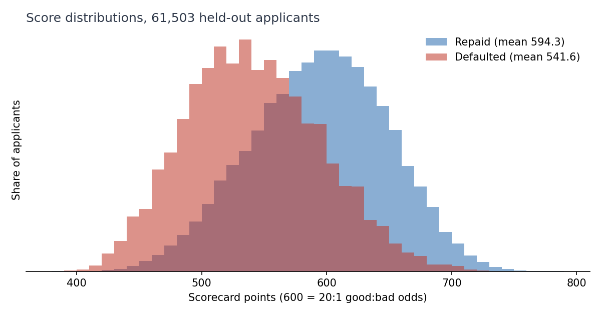
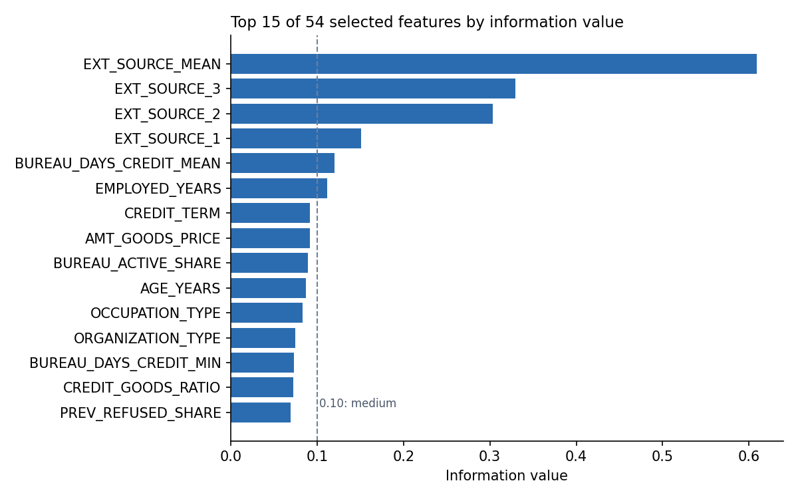

# Credit Risk Scorecard

A reason for every decline, and 47% fewer credit losses at an 80% approval rate.

| At a glance | |
|---|---|
| **Who decides** | A consumer lender's credit team, approving or declining each application. |
| **Result** | Approving the top 80% cuts credit losses 47%; AUC 0.754 on 61,503 held-out applicants. |
| **Proof** | 307,511 applications across 8 tables, 69 tests in CI, and a from-scratch logistic regression that matches scikit-learn. |

[](LICENSE)
[](#how-to-run)
[](https://github.com/alvenyuka/Credit-Risk-Scorecard/actions/workflows/ci.yml)

**Live case study:** [credit-risk-alven.vercel.app](https://credit-risk-alven.vercel.app), an approval-policy
explorer, decile chart, calibration table, reason-code example and points table, all rendered from the executed
outputs in `outputs/` (see `demo/README.md`).


## The problem

A consumer lender approves or declines each application. Approving a borrower who defaults costs the amount
lent times the loss given default; declining a borrower who would have repaid costs the margin on a good loan.
Under fair-lending rules the lender also owes every declined applicant a reason, which a black-box model cannot
give line by line. The question: **how much credit loss can a fully explainable scorecard remove, and what does
its readability cost against a stronger black-box model?**

## How it works


1. **Data and sample.** Application ratios (credit to income, annuity to income, credit term) and applicant-level
   aggregates of bureau history, previous applications, instalments and card balances. A random 20% holdout
   (61,503 applicants, stratified) is kept back and never used in fitting.
2. **Characteristic analysis.** Numeric characteristics start from decile bins and are coarse-classed:
   neighbouring bins merge until the default rate moves in one direction, with a separate bin for zero in
   mostly-zero columns. Categoricals are binned by level. Each bin is replaced by its Weight of Evidence, smoothed
   for sparse bins.
3. **Variable selection.** Three gates a reviewer can check: information value below 0.01 is dropped; of any pair
   of WoE columns correlated above 0.9 the higher-IV one is kept; any characteristic whose coefficient takes the
   wrong sign once the others are in the model is removed and the model refitted.
4. **Model fit.** A class-balanced logistic regression fitted by gradient descent on standardised WoE values.
   WoE, IV, the solver and the AUC, KS, GINI and PSI metrics are implemented in `src/` and tested against
   scikit-learn and scipy; predictions correlate with scikit-learn's fit at 0.999999.
5. **Scaling.** The intercept is shifted from the 50/50 prior of the balanced fit back to the training default
   rate, then coefficients become points: 600 points at 20:1 good-to-bad odds, 40 points to double the odds.
6. **Use.** Each applicant gets a score, the reason codes for a decline, and a place against the approval
   cut-off; the live case study renders the same outputs.

## Stack

| Layer | Tool | Version |
|---|---|---|
| Language | Python | 3.13.9 for the published run; CI on 3.11 and 3.13 |
| Data | pandas, NumPy, pyarrow | 3.0.3, 2.4.6, 24.0.0 |
| Statistics and model | own WoE, IV, logistic regression and metrics in `src/`; scikit-learn and scipy as test references | 1.8.0, 1.17.1 |
| Benchmark | LightGBM (challenger only) | unpinned |
| Charts | matplotlib | 3.9.2 |
| Tests and CI | pytest, GitHub Actions | 8.3.3 |
| Case study | static page on Vercel, data embedded from `outputs/` | |

Versions are recorded in `outputs/results.json` (run of 2026-10-06, commit `75ef602`).

## Results

A points-based credit scorecard that tells a lender which applicants are likely to default and gives a specific reason for every decline. Built on 307,511 Home Credit applications across 8 linked tables, it narrows 62 candidate characteristics to 32 and scores 61,503 held-out applicants at AUC 0.754; approving only the top 80% would have cut credit losses by 47%. Every figure on this page is written by the pipeline and checked by 69 tests in CI. The model is reviewed the way a bank's validation team would review it, findings
included, in [`docs/VALIDATION_REPORT.md`](docs/VALIDATION_REPORT.md).

- 307,511 applicants with a known outcome, 8.1% of whom defaulted, from the application and seven linked tables.
- 62 candidate characteristics, 32 kept after the three gates; 27 of 27 numeric characteristics monotonic.
- 61,503 held-out applicants scored once.
- 69 tests pass in CI, with no data needed.

| Metric (61,503 held-out applicants) | Value |
|---|---:|
| AUC (95% bootstrap interval) | **0.754** (0.747 to 0.761) |
| KS | **0.381** |
| GINI | 0.508 |
| Default rate, lowest vs highest score decile | 26.4% vs 1.3% |
| Mean score, repaid vs defaulted (observed range 389 to 787) | 594 vs 542 |
| Good-to-bad odds at 600: scorecard vs observed (scores 580 to 620) | 20.0 vs 20.2 |
| Largest gap, predicted vs observed default rate (by decile) | 0.4 points |
| Score stability, training vs holdout (PSI) | 0.0002 |

Calibration holds: after the intercept correction, predicted and observed default rates agree within 0.4
percentage points in every decile, so the score can be read as a probability of default.

### How a decline is explained

Every characteristic gives a fixed number of points per bin, so a decline is explained by the characteristics
on which the applicant lost the most points against the best possible answer. A characteristic on which the
applicant already scored the maximum is never given as a reason. For a defaulted holdout applicant who scored
530, below the 541 cut-off of the 80% policy: *external bureau score 3, 58.1 points below the best band;
education level, 43.1 points below the best; average external bureau score, 27.5 points below the best.* The
points for every bin are in [`outputs/scorecard_points.json`](outputs/scorecard_points.json).

## Business impact

On the holdout, approve only the highest-scoring share of applicants. Credit loss is the credit amount of each
approved loan that defaulted, times a loss given default of 45% (the Basel foundation-IRB value for senior
unsecured lending). Home Credit does not state its currency, so amounts are in the dataset's units. Produced by
`src/business_impact.py` into `outputs/business_impact.json`.

| Policy | Approved | Default rate | Credit loss | Loss avoided | Good borrowers declined |
|---|---:|---:|---:|---:|---:|
| Approve everyone | 61,503 | 8.1% | 1.25 bn | n/a | 0 |
| Approve top 90% (score ≥ 514) | 55,353 | 6.0% | 0.89 bn | 29% | 8.0% |
| Approve top 80% (score ≥ 541) | 49,202 | 4.9% | 0.66 bn | **47%** | 17.2% |
| Approve top 70% (score ≥ 560) | 43,052 | 4.1% | 0.50 bn | 60% | 27.0% |

At a 90% approval rate the scorecard removes 29% of credit losses while turning away about one good borrower in
twelve. Where to set the cut-off depends on the margin earned on a good loan against the loss on a bad one,
which this table lets a credit committee price directly.

## Charts


*Loss falls fastest between approving everyone and approving 80%; past that, each step declines more good
borrowers for less loss removed.*



*Repaid and defaulted applicants overlap, as they do in any real book, but their mean scores sit 52 points apart.*



*External bureau scores dominate. The average of the three (IV 0.61) was checked for leakage and kept, because
all three scores exist when the application is made. Bureau credit age, the share of active bureau credit and
the share of previous applications refused also rank in the top 15.*

## Data

| Source | Link | Terms | Size | Period | Refresh |
|---|---|---|---:|---|---|
| Home Credit Default Risk | [Kaggle](https://www.kaggle.com/competitions/home-credit-default-risk) | Kaggle competition rules | 307,511 applicants, 8 CSV tables | undated (no application dates) | static |

The application table plus seven linked tables: credit-bureau records, previous applications, instalments and
card balances. The CSVs are not committed; place them in `data/`.

## Key design decisions

- **Coarse classing over ten equal bins.** With equal bins only 11 of 32 numeric characteristics had points
  moving one way, so a safer bin could earn fewer points than a riskier neighbour. `src/challengers.py` compared
  both on the development applicants under a rule fixed beforehand: adopt coarse classing if it costs no more
  than 0.005 AUC on a validation slice. It cost 0.003 and was adopted. On the holdout the published AUC moved
  from 0.759 to 0.754, calibration tightened, and the loss avoided at 80% approval rose from 46% to 47%.
- **A scorecard over LightGBM.** LightGBM on the same 62 candidates reaches a holdout AUC of 0.781, 0.027 above
  the scorecard. That is the recorded price of a model whose every point has a reason
  ([`outputs/challengers.json`](outputs/challengers.json)); LightGBM stays a benchmark.
- **A sign gate instead of keeping every predictive characteristic.** Fifteen characteristics, among them age,
  the number of bureau records and previous applications, and the credit amount, took the opposite sign once
  correlated characteristics were in the model. Left in, they would have given points to riskier bins; after the
  gate every remaining coefficient is negative.
- **The pensioner placeholder read as missing.** `DAYS_EMPLOYED` holds 365,243 days for pensioners and the
  unemployed. It is set to missing, so that group is read through the `Missing` bin of years employed and
  receives positive points, in line with its lower default rate.
- **Fair-lending exclusions, tested.** Sex (`CODE_GENDER`) and marital status (`NAME_FAMILY_STATUS`) are
  prohibited bases under the US Equal Credit Opportunity Act and Regulation B; a test fails if either is
  reintroduced. Adding both back would move AUC from 0.7540 to 0.7553 only. Age is removed by the sign gate, so
  no applicant aged 62 or over receives negative points, and an acceptance check runs on every build.

## Limits

- **Random, not out-of-time, validation.** The dataset has no application dates, so a forward time split cannot
  be built and calibration on a later population is untested.
- **Loss side only.** The policy table applies one 45% LGD and does not model interest earned on good loans.
- **PD only.** A full IFRS 9 provision also needs loss-given-default and exposure-at-default models.
- **Selection, not volume, carries the result.** 32 characteristics reach AUC 0.754 against 0.751 for an
  earlier 400-candidate version of this pipeline (its README at commit `a8708a0~1`).

## Project structure

```
src/                          features, WoE/IV, logistic regression, metrics, scorecard and checks,
                              run_pipeline.py (the release run), figures, business_impact.py, challengers.py
tests/                        69 tests: statistics vs scikit-learn and scipy, binning, scorecard arithmetic,
                              screening gates, fair-lending checks, policy arithmetic
outputs/                      results.json, business_impact.json, scorecard_points.json, challengers.json,
                              notebook_run.json (date, runtime and versions of the stored notebook run)
figures/                      charts drawn from the same model
figs/                         charts drawn by the notebook (plus four left over from an earlier pipeline's demo)
output/                       demo data left over from that earlier pipeline; the live page reads outputs/
demo/                         the live case-study page and how to redeploy it
Credit_Risk_Scorecard.ipynb   the analysis in four parts, executed end to end
build_notebook.py             generates the notebook (edit this, not the .ipynb)
docs/METHODOLOGY.md           full method, results and test descriptions
docs/VALIDATION_REPORT.md     model validation: soundness, discrimination, calibration, benchmarks, findings
notes/                        the week-by-week build log, mistakes and corrections included
```

The notebook builds the scorecard step by step: what the data can support, building the scorecard, validation
and use, and limits with a decision log of 12 modelling choices. It asserts that its build equals the tested
pipeline and that every figure equals `outputs/results.json`. The full method and tests are in
[`docs/METHODOLOGY.md`](docs/METHODOLOGY.md), and the blind rebuild behind the scorecard, two bugs included, is in
[`notes/`](notes/README.md).

## How to run

```bash
pip install -r requirements.txt    # pinned to the versions in outputs/results.json
python -m pytest                   # 69 tests, no data needed
# put the 8 Home Credit Default Risk CSVs from Kaggle in data/
python src/run_pipeline.py         # one fit: score, check and write outputs/ (15 to 20 minutes the first time)
python src/make_figures.py         # score distribution and default rate by band (seconds)
python src/business_impact.py      # approval-policy table, lending-policy and IV charts (seconds)
python src/challengers.py          # coarse classing and LightGBM against the decile scorecard (about 15 minutes)
```

## Skills demonstrated

- Weight of Evidence binning, coarse classing and Information Value screening, coded by hand: `src/`
- Logistic regression by gradient descent, verified against scikit-learn: `src/`, `tests/`
- Scorecard scaling, prior correction and reason codes: `outputs/scorecard_points.json`
- Validation with AUC, KS, GINI, bootstrap intervals, decile calibration and PSI: `outputs/results.json`
- An approval policy priced in expected loss with a stated LGD: `src/business_impact.py`
- Champion-challenger testing under a rule fixed in advance: `src/challengers.py`
- Fair-lending controls enforced as tests: `tests/`
- Reproducible delivery: pinned requirements, CI on two Python versions, a live case study built from the outputs

## License

MIT. See [`LICENSE`](LICENSE). Data: [Home Credit Default Risk](https://www.kaggle.com/competitions/home-credit-default-risk) (Kaggle).

Alven Yuka · [LinkedIn](https://www.linkedin.com/in/alven-yuka-610b78174/) · [Email](mailto:alvenyuka2@gmail.com)
